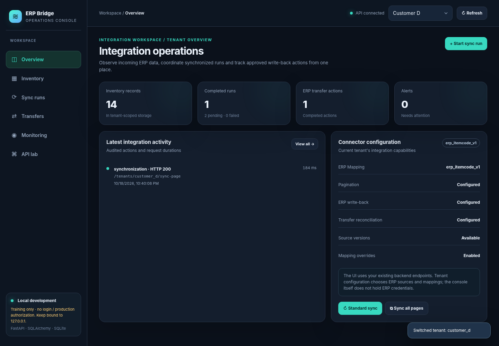

# ERP Bridge
[](https://github.com/Khaled-NasrElDin/ERP-bridge-showcase/actions/workflows/ci.yml)

### Multi-Tenant ERP Integration and Inventory Synchronization

**A runnable Python and FastAPI engineering project exploring how heterogeneous ERP systems exchange inventory data through a canonical model.**

ERP Bridge demonstrates API integration, configurable field mappings, tenant-specific inventory, recoverable synchronization, controlled write-back, and operational monitoring. It uses fictional tenant data and a local mock ERP server. It is a learning and portfolio prototype, not a production-secured integration platform.

**[Live interactive showcase](https://khaled-nasreldin.github.io/ERP-bridge-showcase/)** | **[Real Python backend](backend/)** | **[Architecture](docs/architecture.md)** | **[Security and limitations](docs/security-and-limitations.md)**



*Screenshot of the original local FastAPI operations console, using synthetic ERP data.*

## Two ways to explore the project

| Experience | What it demonstrates |
| --- | --- |
| **[Browser showcase](https://khaled-nasreldin.github.io/ERP-bridge-showcase/)** | A static HTML, CSS, and JavaScript demonstration with fictional data and simulated interactions. No backend server is connected. |
| **[Runnable backend](backend/)** | Actual FastAPI routes, HTTP requests to a local mock ERP, JSON-driven mappings, SQLite persistence, synchronization logic, transfer workflows, and monitoring. |

The browser showcase and the Python backend are separate experiences. The hosted website does not execute Python or perform real ERP transactions.

## Engineering capabilities

| Area | Implementation in the runnable backend |
| --- | --- |
| **Multi-tenant integration** | Tenant-specific configuration, inventory queries, and storage keys |
| **Canonical data mapping** | External-to-internal JSON mappings, schema inspection, validation, and mapping overrides |
| **Inventory synchronization** | HTTP ingestion from mock ERP APIs, normalization, and database upserts |
| **Pagination and recovery** | Sequential page processing, synchronization runs, and persistent checkpoints |
| **Version-aware updates** | Conditional updates designed to avoid replacing newer inventory revisions with older ones |
| **Controlled write-back** | Draft, approve, and execute flow for mock warehouse transfers, with idempotency and reconciliation handling |
| **Observability** | Integration events, request timing, run summaries, alerts, and a local operations console |

For design decisions and trade-offs, see the [architecture documentation](docs/architecture.md).

## Run the real backend locally

**Requirements:** Python 3.10 or newer. Run these commands from the repository root:

```bash
cd backend
python -m venv .venv
```

Activate the environment:

- **Windows PowerShell:** `.venv\Scripts\Activate.ps1`
- **macOS/Linux:** `source .venv/bin/activate`

Install dependencies and initialize the local database:

```bash
python -m pip install -r requirements.txt
python dev_bootstrap.py
```

Start the mock ERP server in one terminal, from `backend`:

```bash
python -m uvicorn mock_erp:app --host 127.0.0.1 --port 8001
```

Start the ERP Bridge API in a second terminal, also from `backend`:

```bash
python -m uvicorn main:app --host 127.0.0.1 --port 8000
```

You can now access:

- **Operations console:** http://127.0.0.1:8000/console
- **Interactive API documentation:** http://127.0.0.1:8000/docs
- **Health endpoint:** http://127.0.0.1:8000/health

To try a genuine backend synchronization using *synthetic* records, open the API documentation and call `POST /tenants/customer_d/sync-all-pages`, followed by `GET /tenants/customer_d/inventory`. The first endpoint requests data from the local mock ERP, normalizes it, and stores it in SQLite. The second reads the persisted inventory.

See [backend/README.md](backend/README.md) for additional instructions and limitations.

## Tests and code examples

Run backend tests from inside `backend`:

```bash
python -m pytest tests -q
```

The repository also includes simplified, standalone public examples in [`examples/`](examples/) and separate standard-library tests in [`tests/`](tests/). From the repository root:

```bash
python -m examples.run_demo
python -m unittest discover -s tests -v
```

**CI status:** The current GitHub Actions workflow runs the standalone public example tests. Backend test automation is a planned improvement; backend tests can already be run locally.

## Repository layout

```text
erp-bridge-showcase/
├── backend/                     # Runnable FastAPI application and mock ERP
│   ├── main.py
│   ├── mapping_engine.py
│   ├── db.py
│   ├── mock_erp.py
│   ├── writeback.py
│   ├── observability.py
│   ├── console_routes.py
│   ├── bridge_console.html
│   ├── tests/
│   └── README.md
├── docs/                        # Architecture, limitations, and static website
│   ├── index.html
│   └── assets/operations-console.png
├── examples/                    # Standalone educational Python examples
├── tests/                       # Tests for those standalone examples
└── .github/workflows/ci.yml
```

## Technology stack

Python, FastAPI, Pydantic, HTTPX, SQLAlchemy, SQLite, REST APIs, JSON configuration, HTML, CSS, JavaScript, pytest, unittest, and GitHub Actions.

## Security and project scope

**Run the backend on localhost only. Do not expose it to the public internet.** This prototype does not implement production authentication or tenant authorization. Tenant-specific database filtering is not access control. Mock ERP configurations point to `127.0.0.1`, and data is synthetic. Local database files, environment variables, and secrets should never be committed.

The project also has learning-stage architectural limitations, including a lack of production-grade migrations, comprehensive end-to-end tests, and deployment hardening. See [backend/README.md](backend/README.md) and [Security and limitations](docs/security-and-limitations.md).

## Author

Built by **Khaled Nasr El Din** as an independent software engineering portfolio project.

[GitHub](https://github.com/Khaled-NasrElDin) | [LinkedIn](https://www.linkedin.com/in/khaled-nasreldin/)

**Copyright 2026 Khaled Nasr El Din. All rights reserved.** No open-source license is granted by this repository. Contact the author for reuse permissions.
