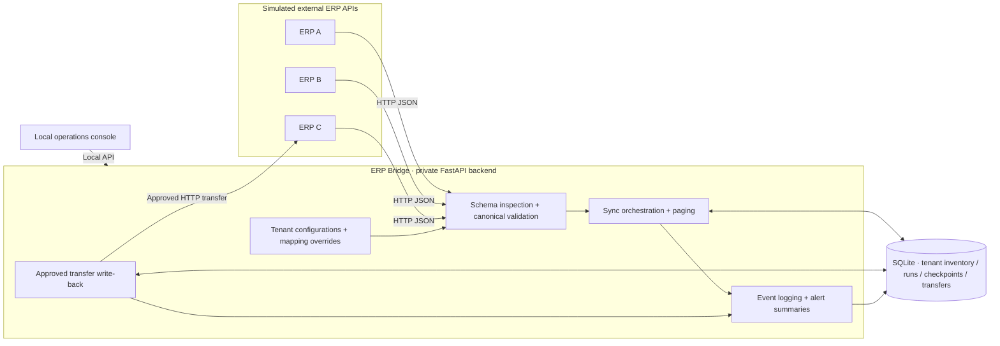

# ERP Bridge

### Multi-Tenant ERP Integration & Inventory Synchronization

**A Python / FastAPI engineering prototype exploring how heterogeneous ERP systems can exchange inventory data reliably through a canonical model.**

[Explore the architecture](docs/architecture.md) · [See the operations console](#operations-console) · [Run the public examples](#run-the-public-examples) · [Security & limitations](docs/security-and-limitations.md)


*Actual screenshot from the local ERP Bridge operations console; values come from a simulated ERP environment.*

---

## The problem

ERP integrations tend to accumulate customer-specific adapters: one system calls a product identifier `product_id`, another uses `itemCode`; stock quantities, warehouses, and inventory formats vary as well. A successful connection is not enough: integrations must also handle incomplete payloads, interrupted transfers, duplicate operations, and ambiguous upstream outcomes.

**ERP Bridge** is a personal engineering project built to experiment with those problems in a controlled, multi-tenant inventory workflow. It uses simulated upstream ERP APIs and a local relational database; **it is not a deployed, production-secured integration service.**

## Capabilities in the private prototype

| Area | Demonstrated behavior |
| --- | --- |
| **Multi-tenant inventory** | Per-tenant configuration and inventory records keyed by tenant, SKU, and warehouse |
| **Canonical normalization** | JSON-driven external-to-internal field mappings, schema inspection, and tenant-specific overrides |
| **Inventory synchronization** | Validation before database writes, database upsert patterns, and page-level commits |
| **Pagination and recovery** | Tracked synchronization runs, checkpoints, sequential page handling, and recovery from the last committed page |
| **Version-aware writes** | Conditional updates that protect newer source versions from being replaced by older ones |
| **Controlled ERP write-back** | Draft → approve → execute flow with idempotency identifiers and uncertain-outcome reconciliation |
| **Observability** | Tenant-scoped request events, response status, elapsed time, run summaries, and alerts |
| **Operations console** | Local interface for inventory, runs, transfers, monitoring, and API exploration |

> **Scope:** These describe behavior implemented in the private learning prototype, not production-level guarantees. The public Python examples below are independent, intentionally simplified illustrations—not the private engine.

## Architecture at a glance



*Conceptual view of the implemented local prototype; see the [detailed architecture](docs/architecture.md).*

## Operations console

The project's local console makes system behavior visible without having to inspect each API response separately. The real interface includes:

- Tenant-level operational overview and inventory explorer
- Tracked synchronization runs with pagination controls
- Approval and execution controls for simulated warehouse transfers
- Monitoring and alerts for recent integration activity
- API lab linking to FastAPI's Swagger documentation

**[View the static, browser-based portfolio demonstration](docs/index.html)** (open locally or enable GitHub Pages for this repository). This *public demonstration is a simulated interface*, not a connected ERP integration and cannot modify inventory in a real system.

## Reliability decisions worth examining

**Normalize before persisting.** External field names are resolved through a mapping and validated against a canonical inventory model; missing required fields can reject a batch before database writes.

**Treat a page as a commit unit.** A page's inventory changes and its sync progress are committed together, allowing later work to resume from an acknowledged checkpoint.

**Avoid overwriting newer records.** For versioned ERP feeds, conditional conflict updates preserve the latest known source revision.

**Don't blindly retry side-effecting writes.** A warehouse transfer has an action ID and a state machine; when a remote outcome is uncertain, the prototype marks it for reconciliation rather than sending the same transfer without checking.

**Separate tenants in storage.** The tenant ID participates in the inventory primary key and scopes inventory queries. **This does not substitute for authentication or authorization.**

These engineering choices, trade-offs, and known limitations are expanded in [Architecture](docs/architecture.md) and [Security & limitations](docs/security-and-limitations.md).

## Run the public examples

The open portion is deliberately small, self-contained, and **uses synthetic data only**. It demonstrates readable Python, mapping overrides, discrepancy detection, and automated tests without publishing the original business logic.

Prerequisite: **Python 3.10+**. No external packages or database are required for these samples.

```bash
python -m examples.run_demo
python -m unittest discover -s tests -v
```

To preview the static HTML showcase:

```bash
python -m http.server 8080 --directory docs
```

Then open `http://127.0.0.1:8080` in your browser. (This is not the real FastAPI console.)

## Repository contents

```text
erp-bridge-showcase/
├── README.md
├── docs/
│   ├── index.html                # Static, synthetic portfolio experience
│   ├── assets/operations-console.png
│   ├── architecture.md
│   ├── security-and-limitations.md
│   └── demo-walkthrough.md
├── examples/
│   ├── sample_mapping.py         # Standalone, illustrative mapping logic
│   ├── sample_reconciliation.py # Standalone, illustrative data checks
│   └── run_demo.py
├── tests/                        # Tests for the public examples only
└── .github/workflows/ci.yml
```

## Technology stack

**Private application:** Python · FastAPI · Pydantic · HTTPX · SQLAlchemy · SQLite · JSON configuration · HTML / CSS / JavaScript.

**Public examples:** Python standard library · `unittest` · GitHub Actions CI.

## What is intentionally not included

The full FastAPI backend, original tenant configuration engine, synchronization orchestration, write-back handling, database models, and local console implementation live in a **separate private repository**. The public examples have been written as *illustrative standalone code*, not extracted wholesale from the private project.

This boundary protects the original implementation from unauthenticated source access. It does **not** prevent someone from copying screenshots, designs, or code that is deliberately public.

## Status and roadmap

**Status:** Local engineering prototype with simulated ERP connectors; not a commercial or production deployment.

Potential next engineering steps: authentication and tenant authorization; consolidated database migrations; more isolated integration tests; resilient concurrency handling; broader reconciliation/reporting; containerized reproducible setup; and a more modular FastAPI application structure.

## Author and usage

Built by **Khaled Nasr El Din** as an independent software engineering portfolio project.

[GitHub profile](https://github.com/Khaled-NasrElDin) · [LinkedIn](https://www.linkedin.com/in/khaled-nasreldin/)

**Copyright © 2026 Khaled Nasr El Din. All rights reserved.** This showcase is provided for portfolio evaluation. No open-source license is granted for copying or adapting the code. GitHub's applicable platform terms still apply. Contact the author for reuse permissions.
