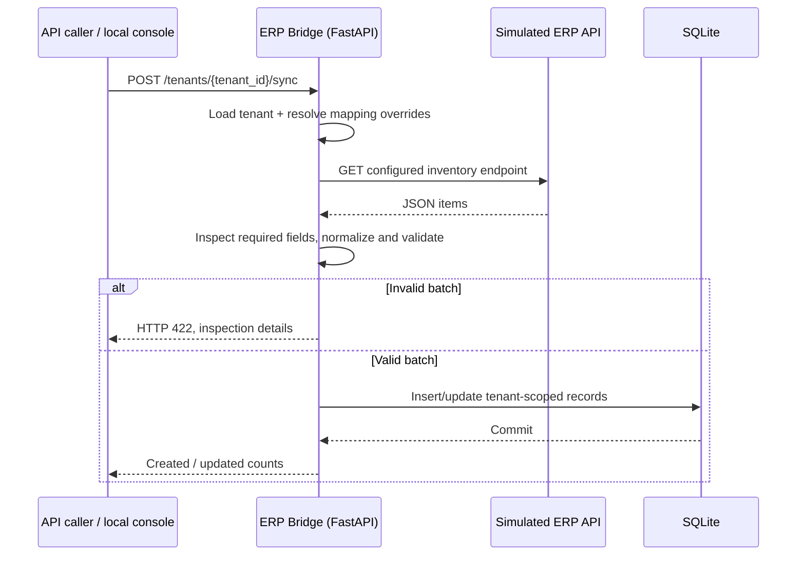
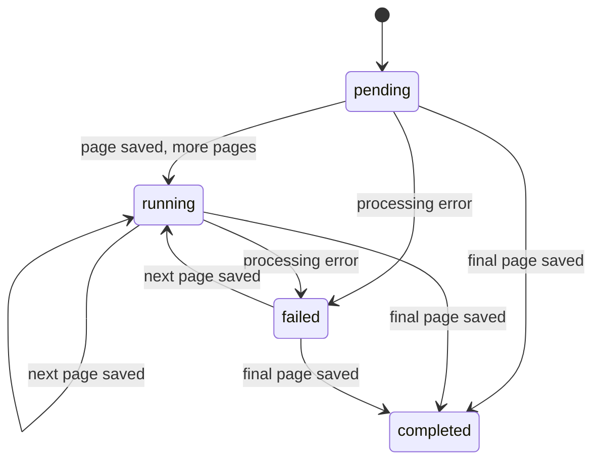
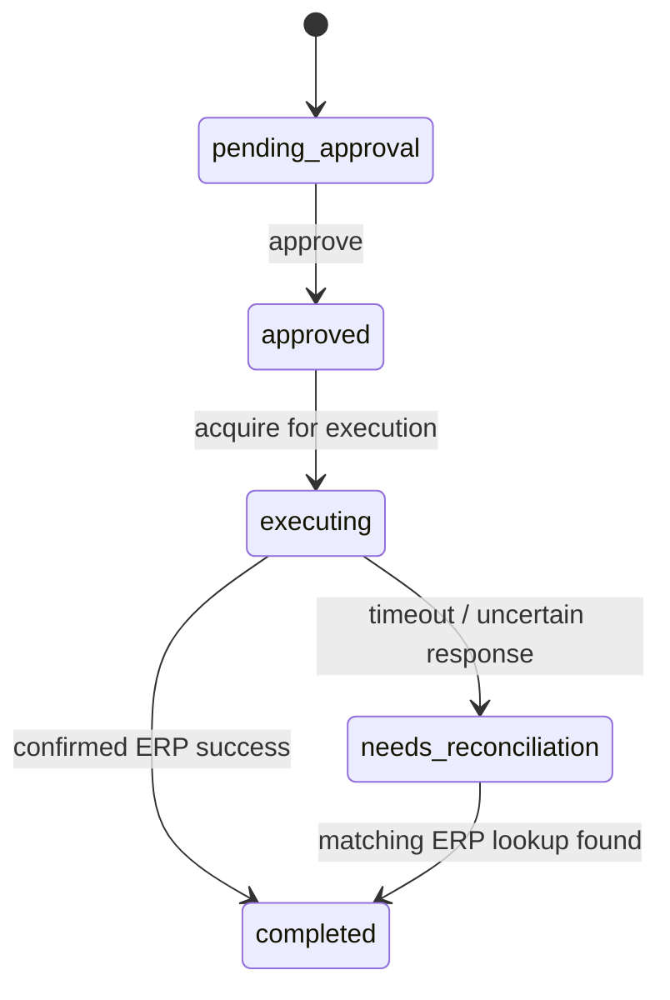

# Architecture and engineering decisions

[← Back to the project overview](../README.md)

## Context and system boundary

ERP Bridge is a **local engineering prototype**, not an integration to real enterprise customers. A simulated ERP API returns heterogeneous JSON payloads. The private FastAPI service selects a tenant configuration, validates and normalizes the payload, and persists inventory in SQLite. A locally hosted operations console uses FastAPI endpoints to inspect synchronization activity.

The public repository contains architectural documentation and reduced demonstrations; it does **not** contain the original application service code.

## Read-side pipeline: Inventory synchronization

**Why mapping overrides?** Multiple simulated customers can share a common schema and override only names that differ. The program matches explicit keys; it **does not infer unknown business semantics automatically**.

**What if the ERP sends extra fields?** The schema inspection can identify unknown fields. The current normalization path only translates configured fields; extra fields are not automatically persisted.

## Recovery: Page-level commit and checkpoints

In the private paginated flow, incoming data is validated and mapped before persistence. A page's inventory updates and run/checkpoint progress are committed in the same database transaction. A version-aware upsert can condition updates on source revisions. Tracked run IDs preserve progress across failed attempts.

There is also a legacy, run-independent checkpoint route in the original prototype. It is retained for experimentation and is distinct from tracked-run recovery.

## Write-back: Controlled transfer flow

The simulated transfer workflow creates an action, requires an explicit approval step, and then sends a transfer POST to the mock ERP. The transfer action ID is also supplied as an idempotency identifier. A response timeout is treated as an **unknown remote outcome**, not proof that the transfer failed.

**Important boundary:** the local approval state is not an authenticated authorization step. The simulated ERP keeps transfer idempotency state in process memory, so it does not provide durable cross-restart guarantees.

## Data model — conceptual

| Record | Main identifying fields | Purpose |
| --- | --- | --- |
| TenantInventoryRecord | `tenant_id`, `sku`, `warehouse` | Inventory state separated by tenant |
| SyncCheckpoint | `tenant_id`, `sync_name` | Legacy feed-level progress |
| SyncRun | `run_id` | Tracked synchronization attempt and last page |
| TransferAction | `action_id` | Approval, execution, and reconciliation state |
| IntegrationEvent | `event_id` | HTTP activity, response status, elapsed time |

## Observability

An integration middleware records selected POST requests, tenant identity from the path, HTTP outcomes and request duration. Tenant-scoped summary endpoints aggregate recent errors, failed runs, and transfers marked for reconciliation.

This is operational instrumentation, **not** a complete business-level reconciliation of every ERP source record against every destination record. A successful HTTP response does not prove inventory freshness or completeness.

## Design trade-offs

- **Why SQLite?** Accessible and easy to understand for local experiments; not a production database architecture for distributed concurrent integration workloads.
- **Why configuration-based mappings?** Explicit, traceable field correspondences; the cost is onboarding and maintenance of per-ERP semantic knowledge.
- **Why page-level transactions?** Progress can be tracked and resumed without repeating every prior page. A multi-page run is not a single globally atomic transaction.
- **Why a separate mock ERP?** Allows repeatable validation of request/response behavior without connecting to client systems.
- **Why a private core?** Recruiters can evaluate the architecture and public samples while the original implementation remains private.

See [Security & limitations](security-and-limitations.md) for important restrictions.
